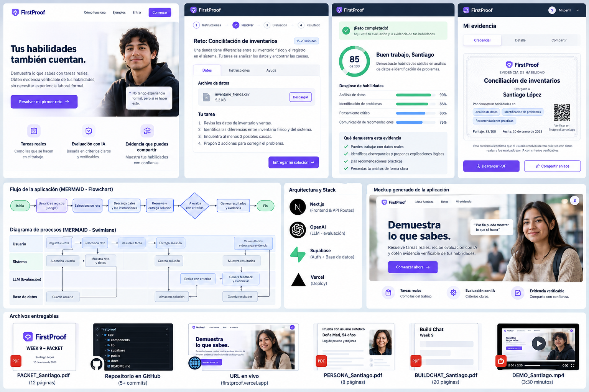
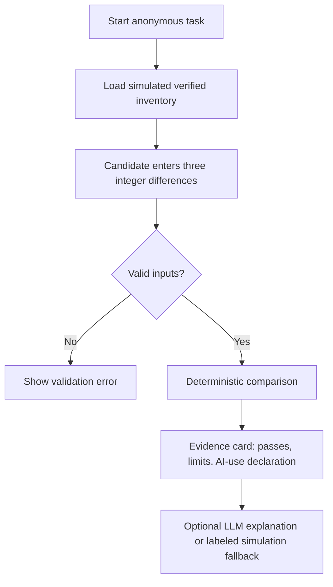
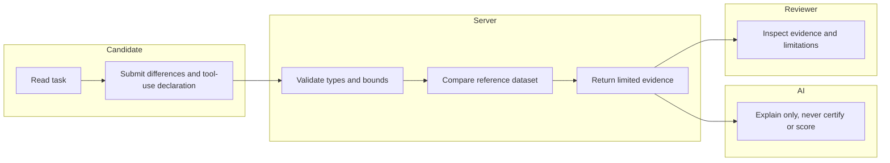

# FIRSTPROOF — Week 9 | BUSINESS BENDING

**Role continuity:** USER. **Declared vacuum:** First-proof. **Status:** working prototype; deploy and authentic persona walkthrough pending.

## Problem in my words
Mexican young adults can perform useful work in family businesses, school and informal employment, but often cannot present small, independently inspectable proof to a prospective employer. AI also compresses entry-level tasks that used to let beginners become observable. The product must not confuse one simulation with verified employment.

## Exact user
Diego, 22, Estado de México, a **simulated composite**: finishes technical studies, helped reconcile stock in a family shop, has no employer-verified evidence. The test is not an actual interview.

## Success definition
**Before the module closes,** Diego can solve a three-SKU reconciliation exercise using structured simulated data, receive deterministic checks, obtain a clearly bounded evidence card, and request an optional AI explanation; the app works on mobile. A reviewer can understand the evidence and its limits in under two minutes. No CV, job board, or automatic hiring score.

## Mockup

**Design disclaimer:** The generated concept includes decorative features such as scores, profiles, credentials, and sign-in that are intentionally **not** part of this build; the implemented interface is the source of truth. We exclude the mockup's global employability score and credential claims because of the shadow clause.

## Flowchart

## Swimlane

## Global benchmark / translation
**Forage** offers employer-style job simulations worldwide. **FirstProof** adapts the concept to Spanish-language Mexican SME inventory work and privileges an inspectable, bounded output over a certificate or hiring prediction. **Jóvenes Construyendo el Futuro** provides a real longer workplace training pathway for eligible youth; our prototype addresses a much smaller proof-before-placement moment. Local employer acceptance remains untested.

## Three-year long view
FirstProof could become a library of small tasks written with Mexican SMEs. Informal workers could bring experience into the same evidence format while clearly separating claimed background from observed performance. Employers would retain final decisions, without universal automated rankings.

## Scope cut
No CV builder, job board, profile, identity verification, employer marketplace, recruitment recommendations, paid features, persistence, database, or real personal data. A task simulation is not a professional certification.

## Architecture + stack
| Component | Technology | Role |
|---|---|---|
| Frontend | HTML/CSS/JS | Responsive Spanish task UI |
| API | Node.js server | Validates all input and bounds |
| Verified structured data | Version-controlled SKU reference in `logic.js` | Deterministic evaluation |
| LLM | OpenAI Responses API (`OPENAI_API_KEY` server-side only) | Optional explanatory feedback, never grades |
| Third DRAGON component | Deterministic matching logic | SKU-by-SKU comparison |
| Hosting | Vercel / Node runtime | Public access after deploy |

## Shadow and security floor
**Shadow:** disappearing junior work replaced by another opaque algorithmic gate. **Design decision:** no opaque employability score; display task-level checks and explicit unverified claims. Keys only in server environment, no database or personal data, no auth needed for stateless anonymous tasks; strict numeric validation, 4 KB request cap, no raw free-text prompts, all seed data labeled simulated. If auth/storage is added later, Supabase Auth + RLS are required first.

## Test plan
1. Correct answers `[-2,3,0]` => 3/3.
2. Wrong answers `[0,0,0]` => 1/3.
3. NaN, out-of-range, wrong answer count, invalid AI declaration => rejected.
4. Blank field => client-side validation.
5. Server without API key => clearly labeled simulated feedback.
6. API key present => LLM explanatory feedback, no scoring.
7. Mobile layout and screen-reader labels.
8. Fresh-chat persona walkthrough with sequential actual screenshots; log and fix worst observed confusion.

## Acceptance boundaries
A passing mechanical test does not establish real-world employer trust. A synthetic persona does not replace real interviews. Deployment, screenshot walkthrough, and video must be independently verified before claiming course completion.
